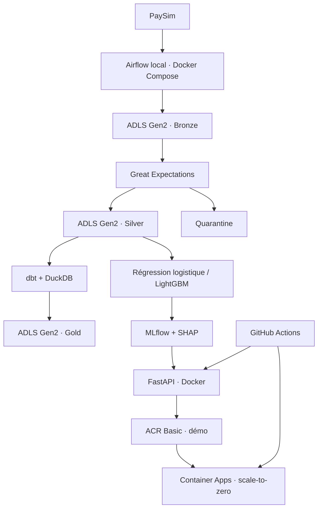

# Plateforme de détection de fraude

Projet portfolio Data Engineering et Data Science : construire progressivement
une plateforme de détection de fraude, de l'ingestion au scoring cloud.
PaySim fournit les données de transactions simulées utilisées dans le projet.

**État : semaines 1 à 4 terminées.** Bronze, Silver et Gold sont disponibles sur ADLS Gen2. La régression logistique et LightGBM ont été comparés, enregistrés dans MLflow et le score LightGBM a été expliqué avec SHAP. Le déploiement de l'API reste à faire.
Les performances seront publiées uniquement après évaluation reproductible.

## Architecture cible



Ce schéma décrit la cible, pas des composants déjà implémentés.

## Démarrage local

Le développement local utilise Python 3.13. Depuis la racine du projet,
créez l'environnement isolé uniquement s'il n'existe pas encore :

```powershell
py -3.13 -m venv .venv
```

Si `.venv` existe déjà, conservez-le et passez directement à l'installation
du package et à l'exécution des tests. L'activation n'est pas nécessaire :

```powershell
.\.venv\Scripts\python.exe -m pip install -e ".[dev]"
.\.venv\Scripts\python.exe -m pytest -q
```

Pour créer les dossiers locaux sans télécharger de données :

```powershell
.\.venv\Scripts\python.exe -c "from pathlib import Path; from fraud_platform.config import DataPaths; DataPaths(Path('data')).create()"
```

## Organisation

```text
src/fraud_platform/   Code Python réutilisable
tests/               Tests automatisés
docs/                Décisions et suivi du projet
data/raw/            Source PaySim originale (hors Git)
data/bronze/         Copie technique en Parquet
data/silver/         Données validées en Parquet
data/gold/           Base DuckDB contenant le modèle analytique
data/quarantine/     Lignes rejetées et motifs en Parquet
```

## Données et prévention des fuites

PaySim contient des transactions financières simulées. Le nom du fichier et
son empreinte sont documentés dans [la fiche source](docs/data-source.md).

Depuis la racine, cette commande analyse le CSV et écrit un rapport JSON local
avec les volumes, les valeurs manquantes, les doublons et les fraudes par type
et par heure simulée (`step`).

```powershell
.\.venv\Scripts\python.exe -m fraud_platform.eda data/raw/PS_20174392719_1491204439457_log.csv --output artifacts/eda/paysim.json
```

L'évaluation utilisera une séparation temporelle par `step`. Les quatre colonnes
de solde et `isFlaggedFraud` seront exclues des variables de scoring ;
`isFraud` sera exclusivement la cible. Les identifiants de comptes ne seront
pas utilisés directement comme variables. Toute transformation apprise sera
ajustée sur l'entraînement uniquement.

## Générer les couches locales

Après l'installation des dépendances et le téléchargement de PaySim, cette
commande construit Bronze, Silver et Quarantine par lots. Chaque couche reçoit
un fichier Parquet nommé d'après le SHA-256 de la source.

```powershell
.\.venv\Scripts\python.exe -m fraud_platform.pipeline data/raw/PS_20174392719_1491204439457_log.csv
```

Les règles de validation et l'identifiant des transactions sont décrits dans
[le contrat de données](docs/data-contract.md).

## Budget et secrets

- Budget Azure cumulé de 30 USD pour l'ensemble du projet, tous services et déploiements compris.
- À 30 USD de coûts cumulés constatés, envoyer un e-mail et prévoir l'arrêt automatique de l'API Container Apps. La décision concernant les données et le stockage reste manuelle. Toute suppression exige une décision explicite.
- Vérifier les frais résiduels des ressources conservées, notamment le registre ACR. Le seuil dépend du délai de remontée des coûts Azure.
- Suivre les coûts dans le groupe dédié `rg-fraud-detection`.
- ACR Basic sera réservé à la démonstration puis supprimé avec les ressources inutiles.
- Aucun secret dans Git, les notebooks, les logs ou les images Docker.
- `.env` et les données sont ignorés ; `.env.example` ne contient aucun secret.
- Managed Identity et fédération GitHub/Azure seront privilégiées si disponibles.

## Suivi

Après validation du projet principal en semaine 5, la semaine 6 couvrira
Terraform, l'analyse NLP des réclamations CFPB et la surveillance de dérive
avec Evidently. Les extensions seront d'abord testées localement, dans le
respect du budget Azure cumulé de 30 USD.

Voir [la checklist de semaine 1](docs/week-01.md), [le suivi de semaine 2](docs/week-02.md), [le guide Gold de la semaine 3](docs/week-03.md) et [les expériences de la semaine 4](docs/week-04.md).
