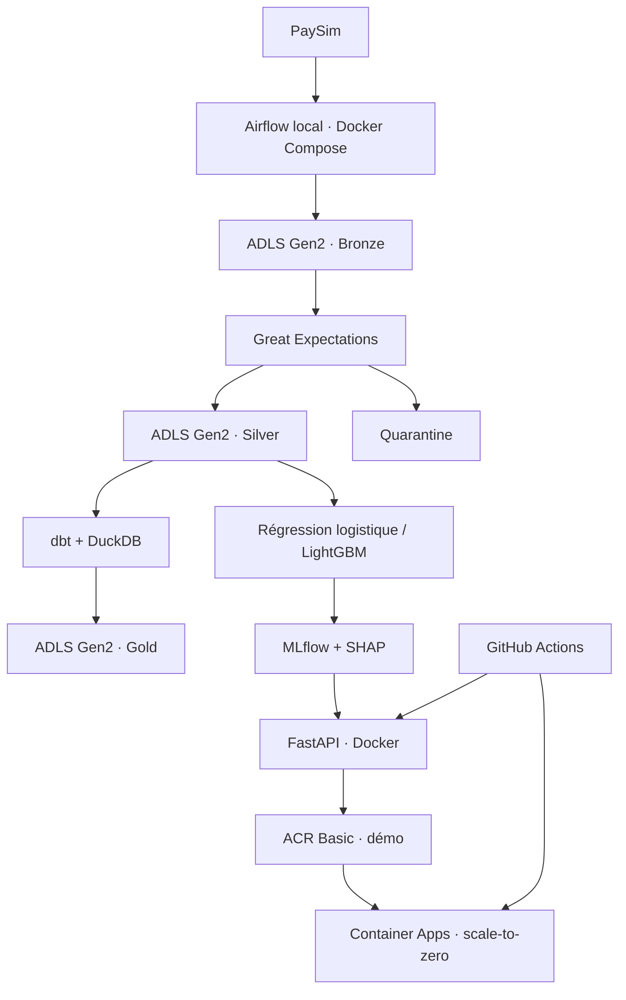

# PaySim Fraud Platform

Projet portfolio Data Engineering et Data Science : construire progressivement
une plateforme de détection de fraude, de l'ingestion au scoring cloud.

**État : semaine 1, socle local.** Aucun modèle entraîné, aucun déploiement Azure.
Les performances seront publiées uniquement après évaluation reproductible.

## Architecture cible



Ce schéma décrit la cible, pas des composants déjà implémentés.

## Démarrage local

Python 3.11 est la version cible pour l'intégration des outils. Depuis la racine,
les commandes PowerShell suivantes créent un environnement isolé, installent
le package avec pytest puis exécutent les tests. L'activation n'est pas nécessaire.

```powershell
py -3.11 -m venv .venv
.\.venv\Scripts\python.exe -m pip install -e ".[dev]"
.\.venv\Scripts\python.exe -m pytest -q
```

Pour créer les dossiers locaux sans télécharger de données :

```powershell
.\.venv\Scripts\python.exe -c "from pathlib import Path; from fraud_platform.config import DataPaths; DataPaths(Path('data')).create()"
```

## Organisation

```text
src/fraud_platform/   Code Python réutilisable
tests/               Tests automatisés
docs/                Décisions et suivi du projet
data/raw/            Source PaySim originale (hors Git)
data/bronze/         Copie technique en Parquet (à construire)
data/silver/         Données validées en Parquet (à construire)
data/gold/           Modèle analytique (à construire)
data/quarantine/     Lignes rejetées (à construire)
```

## Données et prévention des fuites

PaySim contient des transactions financières simulées. Le téléchargement,
la provenance exacte, les conditions d'utilisation et l'empreinte du fichier
seront documentés à l'étape suivante. Le dataset ne sera pas commité.

L'évaluation utilisera une séparation temporelle par `step`. Les soldes après
transaction et `isFlaggedFraud` seront exclus des variables de scoring ;
`isFraud` sera exclusivement la cible. Les identifiants de comptes ne seront
pas utilisés directement comme variables. Toute transformation apprise sera
ajustée sur l'entraînement uniquement.

## Budget et secrets

- Plafond personnel : 90 USD. Aucune ressource Azure créée à ce stade.
- Prévoir des alertes à 5, 15 et 30 USD avant tout déploiement.
- Les alertes budgétaires ne constituent pas un arrêt automatique des dépenses.
- ACR Basic sera réservé à la démonstration puis supprimé avec les ressources inutiles.
- Aucun secret dans Git, les notebooks, les logs ou les images Docker.
- `.env` et les données sont ignorés ; `.env.example` ne contient aucun secret.
- Managed Identity et fédération GitHub/Azure seront privilégiées si disponibles.

## Suivi

Voir [la checklist de semaine 1](docs/week-01.md).
